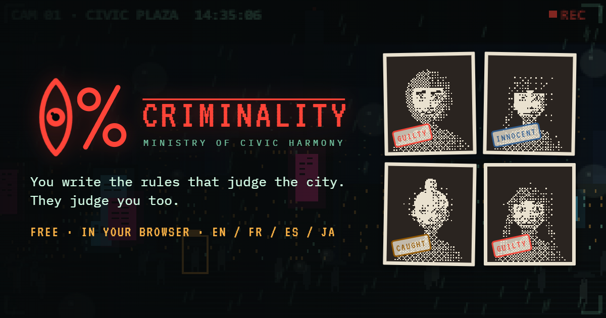
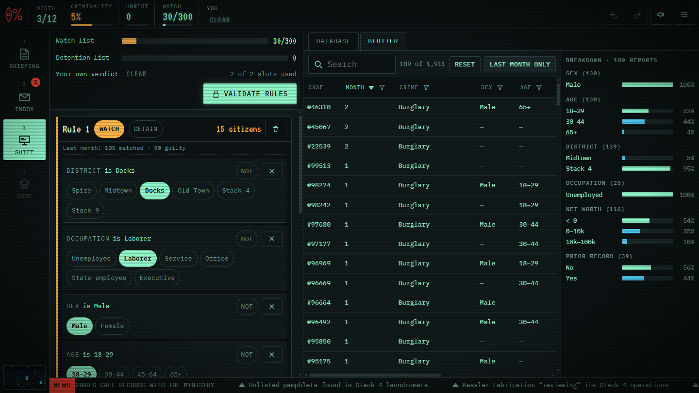
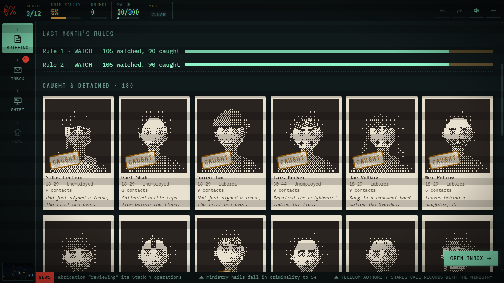
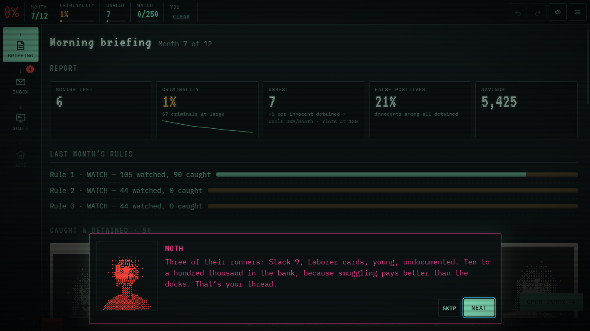

  

<h1 align="center">0% Criminality</h1>

  <b>You write the rules that judge the city. They judge you too.</b> 
  A noir systems game about profiling, complicity, and a sister with nine days of insulin left.

  <a href="https://abaudat.github.io/Criminality0/"><b>▶ PLAY IN YOUR BROWSER</b></a> 
  Free · no install · desktop or phone in landscape · English · Français · Español · 日本語

---

The Minister promised **zero percent criminality within twelve months**. He said it in the rain, on television, so now it's physics.

You are a Systems Architect at the Ministry of Civic Harmony. Every month you write the profiling rules that decide which of ten thousand citizens are **CLEARED**, **WATCHED** or **DETAINED**. Watching is clean but scarce. Detaining is limitless — and every innocent you detain is a family that stops believing in you.

Your own profile is pinned at the top of the database, evaluated by the same rules. You've done nothing wrong. But your district, your debts, your sister and the people you call at night are all columns now.

  

## Read the city

The previous administration left you its crime blotter: hundreds of witness statements — *a man, in his twenties, shabby clothes, Stack 9.* Filter it, sort it, read the breakdown, and the hidden patterns surface. Write a hypothesis, watch the live verdict sweep through the registry, validate, and find out the next morning how many guilty it actually caught.

Every crime in the city comes from rules hidden at design time. Reaching zero is **provably possible** — the question is what you'll do to get there.

  
  

## People, not rows

- **Mira**, your sister, works a noodle counter in Stack 9. She's diabetic, behind on rent, and her residency lapsed two years ago.
- **Haruto Ibe** sold you an umbrella twelve years ago and has been paying "insurance" to the Docks ever since. He'll give you the gang — if you keep his son off your lists.
- **Undersecretary Crane** has been in this building for twenty-two years and was in the first riots. She is not the villain. That's the problem.
- **MOTH** will take over your terminal, hand you a smuggling ring, and ask for one thing in return.

Requests pull you in opposite directions. Every verdict satisfies exactly one side — doing nothing too. At the end of month twelve your career is pinned on a **Lawful–Chaotic / Good–Evil** chart, with four endings and three ways to fail along the way.

## Share your verdict

The final alignment chart animates your path month by month and exports as a **GIF** in one tap. Post it, compare it, argue about it.

## Features

- 11,000 procedurally generated citizens with dithered surveillance portraits, families and contact graphs — identical for every player
- A rules language as small as a hypothesis and as sharp as a policy: conditions, `NOT`, value sets, contact counts
- A filterable, sortable, full-text searchable registry and blotter with live per-field breakdowns
- Undo / redo everything, autosave after every action, restart any month from the timeline
- Synth-noir jazz and rain, generated live in your browser
- Mouse, touch and keyboard (`1–4` phases · `Ctrl+Z / Ctrl+Y` · `/` search · `Esc` menu)

---

Everyone in the registry is fictional. The registry is not.

